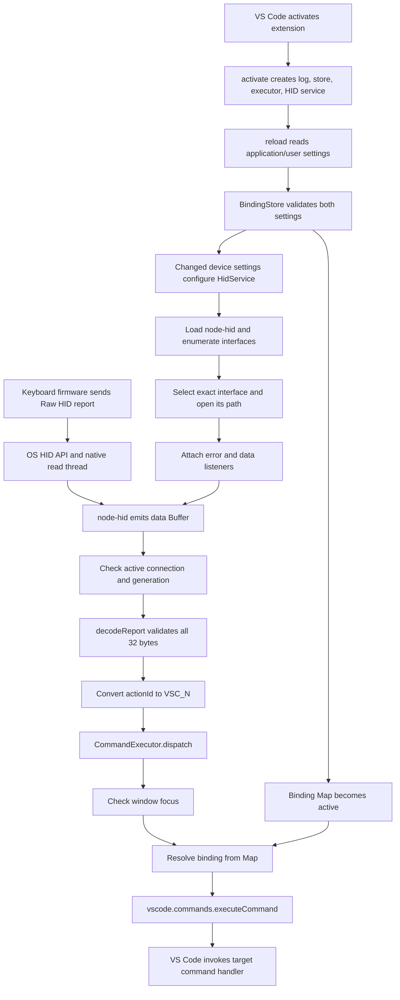

# QMKommand: architecture and codebase guide

This document explains the implementation in this working tree, whose extension manifest currently declares version `0.0.1`. It is intended for a programmer who has never worked on QMKommand. It covers every first-party source file, function, method, test helper, and build/configuration file, including the callbacks that connect the components. Generated files and third-party dependencies are explained by their role rather than cataloguing every file inside `node_modules`.

The source code is the authority if this document and a future implementation diverge. [README.md](README.md) is the shorter installation and usage guide; this document explains how and why the implementation behaves as it does.

## Contents

1. [What the extension actually does](#1-what-the-extension-actually-does)
2. [Repository map](#2-repository-map)
3. [End-to-end execution path](#3-end-to-end-execution-path)
4. [Shared types and conventions](#4-shared-types-and-conventions)
5. [Manifest, activation, and dependency wiring](#5-manifest-activation-and-dependency-wiring)
6. [Configuration validation and binding storage](#6-configuration-validation-and-binding-storage)
7. [HID discovery, capture, and connection lifecycle](#7-hid-discovery-capture-and-connection-lifecycle)
8. [The exact wire protocol](#8-the-exact-wire-protocol)
9. [Resolving and executing VS Code commands](#9-resolving-and-executing-vs-code-commands)
10. [The four utility commands](#10-the-four-utility-commands)
11. [Timing, races, and shutdown](#11-timing-races-and-shutdown)
12. [Diagnostics and failure behavior](#12-diagnostics-and-failure-behavior)
13. [Tests and what they establish](#13-tests-and-what-they-establish)
14. [Compilation, bundling, and development configuration](#14-compilation-bundling-and-development-configuration)
15. [VSIX packaging and verification](#15-vsix-packaging-and-verification)
16. [Boundaries and implementation limitations](#16-boundaries-and-implementation-limitations)
17. [How to make common changes](#17-how-to-make-common-changes)
18. [Suggested reading and debugging paths](#18-suggested-reading-and-debugging-paths)

## 1. What the extension actually does

QMKommand receives an application-specific message from a keyboard's Raw HID interface, interprets one byte as an action number, looks up a user-configured VS Code command, and asks VS Code to execute that command.

There are two distinct notions of a keyboard input here:

- A normal keyboard HID interface reports physical keys/modifiers to the operating system. The OS and VS Code's normal keybinding system process those inputs.
- The Raw HID interface used here carries custom bytes. QMKommand opens that separate interface directly through `node-hid`. A custom report says, effectively, "execute action 0," rather than "the A key is down."

The extension does not install a global keyboard hook, intercept normal typing, translate scan codes, or register 32 normal VS Code keybindings. `VSC_1` through `VSC_32` are names in QMKommand's own configuration and TypeScript types. They are not VS Code command IDs or OS key names.

The keyboard firmware is outside this repository. The repository's documented firmware convention is that a custom key computes an action ID as `keycode - QK_KB_0`, sends a `QMKVSC` report, and uses values 0 through 31. The extension can validate the resulting bytes; it cannot establish when firmware sends them or whether firmware emits only one report per press. Firmware must implement the sending side separately.

VIA is relevant because it may configure the keyboard's custom keycodes or use the same Raw HID interface. QMKommand itself does not implement VIA's configuration protocol, modify a keymap, or send any HID messages. Unrelated traffic is discarded by the decoder unless it happens to satisfy the complete QMKommand format.

The extension runs in a desktop VS Code **local UI extension host**. That host is a process/environment in which VS Code runs extension JavaScript and supplies the `vscode` API. `extensionKind: ["ui"]` places QMKommand locally even when an editor workspace is on SSH, WSL, or another remote machine. This placement matters because the USB keyboard is attached to the local computer. The current packaging script creates only a Windows x64 installation artifact.

## 2. Repository map

Paths below are relative to the repository root.

| File or directory | Responsibility |
| --- | --- |
| [`src/extension.ts`](src/extension.ts) | Entry point; creates components, reads settings, registers utilities, wires HID input to dispatch, and shuts down the service. |
| [`src/types.ts`](src/types.ts) | Shared key, binding, JSON, device, and logger contracts; error formatting helper. |
| [`src/hid/protocol.ts`](src/hid/protocol.ts) | Pure validation and decoding of one input report. |
| [`src/hid/hidService.ts`](src/hid/hidService.ts) | Native dependency adapter, exact interface selection, asynchronous connection worker, input listeners, retries, and cleanup. |
| [`src/bindings/bindingStore.ts`](src/bindings/bindingStore.ts) | Runtime settings validation and atomic replacement of the active bindings/device configuration. |
| [`src/bindings/bindingResolver.ts`](src/bindings/bindingResolver.ts) | Small lookup abstraction used by dispatch. |
| [`src/commands/commandExecutor.ts`](src/commands/commandExecutor.ts) | Focus check, binding lookup, argument handling, command invocation, and command error logging. |
| [`src/commands/registerCommands.ts`](src/commands/registerCommands.ts) | Implementation and registration of the four Command Palette utilities. |
| [`src/test/core.test.ts`](src/test/core.test.ts) | Unit tests for protocol, configuration, and execution; shared test fixtures. |
| [`src/test/hidService.test.ts`](src/test/hidService.test.ts) | HID selection/lifecycle tests using fake devices, handles, timers, and delayed promises. |
| [`src/integration/extension.test.ts`](src/integration/extension.test.ts) | Separate smoke test intended to run inside a real VS Code host. |
| [`package.json`](package.json) | Extension identity and capabilities, configuration schema/defaults, npm scripts, and dependency declarations. |
| [`package-lock.json`](package-lock.json) | Resolved dependency versions, integrity information, and dependency graph used by reproducible npm installs. |
| [`tsconfig.json`](tsconfig.json) | TypeScript language, module, type-checking, and compilation settings. |
| [`eslint.config.mjs`](eslint.config.mjs) | TypeScript ESLint parser/plugin and a small set of style/correctness rules. |
| [`esbuild.js`](esbuild.js) | Development/production extension bundling and watch-mode diagnostics. |
| [`.vscode-test.mjs`](.vscode-test.mjs) | Selects compiled integration tests for the VS Code test CLI. |
| [`.vscode/launch.json`](.vscode/launch.json) | F5 Extension Development Host launch and prelaunch build. |
| [`.vscode/tasks.json`](.vscode/tasks.json) | One-shot build and optional background build/test watchers. |
| [`.vscode/settings.json`](.vscode/settings.json) | Repository editor preferences for generated output visibility/search and task detection. |
| [`.vscode/extensions.json`](.vscode/extensions.json) | Recommended development extensions. |
| [`.gitignore`](.gitignore) | Keeps generated output, dependencies, test downloads, and artifacts out of Git. |
| [`.vscodeignore`](.vscodeignore) | Removes development material and unneeded native binaries from the VSIX. |
| [`scripts/package-vsix.cjs`](scripts/package-vsix.cjs) | Windows x64 platform guard, native load check, and VSIX creation. |
| [`scripts/verify-vsix.cjs`](scripts/verify-vsix.cjs) | Archive extraction, manifest/content assertions, and isolated native dependency load check. |
| [`README.md`](README.md) | User setup, protocol overview, development/install instructions, and manual validation checklist. |
| [`CHANGELOG.md`](CHANGELOG.md) | Human-readable release changes. |
| [`vsc-extension-quickstart.md`](vsc-extension-quickstart.md) | Original extension-scaffold instructions; some sample-command/test references are historical. |
| `dist/` | Generated bundled extension loaded by VS Code; normally `extension.js` and a development source map. |
| `out/` | Generated TypeScript output, retaining source-directory structure; used to run tests. |
| `artifacts/` | Generated VSIX, extraction directories, and `verification.json`. |
| `node_modules/` | Installed third-party runtime and development packages. |
| `.git/` | Git repository metadata; not application code. |

The old files `src/keyboard.ts`, `src/result.ts`, and `src/test/extension.test.ts` are absent from the current implementation. Historical references to them do not describe the current runtime path. In particular, HID handling now belongs to `src/hid/hidService.ts`.

## 3. End-to-end execution path

The following diagram separates startup/configuration from the path taken by each received report.



A concrete example makes the boundaries explicit. Suppose settings contain:

```jsonc
"qmkommand.bindings": [
  { "key": "VSC_2", "command": "type", "args": { "text": "Hello World" } }
]
```

1. During activation, `BindingStore.reload()` validates the settings and stores a binding under Map key `VSC_2`. The argument object is cloned while loading settings.
2. The HID service connects to the configured Raw HID path and registers a `data` callback on its handle.
3. Firmware sends 32 bytes: `51 4D 4B 56 53 43 01 01 01`, followed by 23 zero bytes. The action ID is the third `01`, at offset 8.
4. The native dependency reads the report and delivers a Node `Buffer` in a `data` event.
5. The service rejects the callback if it belongs to an obsolete connection. Otherwise it calls `decodeReport(payload)`.
6. The decoder checks length, signature, version, message type, action range, and reserved bytes. It returns `{ ok: true, event: { actionId: 1, key: "VSC_2" } }`.
7. The service invokes its injected `onKey("VSC_2")` callback. That callback was created in `activate()` and calls `void executor.dispatch(key)`.
8. `dispatch()` samples the current VS Code window's focus state. If the window is unfocused, the event ends here and is not replayed later.
9. `resolveBinding()` calls `store.get("VSC_2")` and obtains the binding.
10. Because the binding has its own `args` property, the executor calls the injected command adapter with two parameters: `"type"` and `{ text: "Hello World" }`.
11. The adapter forwards that call to `vscode.commands.executeCommand("type", { text: "Hello World" })`.
12. VS Code resolves the command ID and invokes the command handler. The command's own implementation determines its editor/context behavior. QMKommand does not type text itself.
13. The executor awaits the command's result so it can catch a rejection. HID reception does not await that dispatch promise, so another report can start another command while this one is pending.

There is no settings-file read, command enumeration, or device enumeration in steps 5–12. Those operations belong to configuration or connection setup.

## 4. Shared types and conventions

Source: [`src/types.ts`](src/types.ts).

### `KeyNumber`, `KeyName`, and `KEY_NAMES`

`KeyNumber` is a non-exported TypeScript union of the integer literals 1 through 32. `KeyName` is exported as a template-literal type, `` `VSC_${KeyNumber}` ``. A correctly typed caller therefore cannot pass `"VSC_0"`, `"VSC_33"`, or an arbitrary string as a `KeyName` without bypassing type checking.

These TypeScript types disappear in emitted JavaScript. Actual settings and HID bytes still require runtime validation.

`KEY_NAMES` is a runtime array generated by `Array.from({ length: 32 }, (_, i) => ...)`. The callback uses zero-based array indices but adds one to construct `VSC_1` through `VSC_32`. Configuration validation uses the array to check key membership; Test Key uses it to construct its picker. The manifest repeats these names explicitly in its JSON schema.

### `JsonValue`

`JsonValue` recursively describes `null`, booleans, numbers, strings, arrays of JSON values, and objects whose values are JSON values. It excludes functions, `undefined`, symbols, and other arbitrary JavaScript values at the type level. Runtime validation additionally rejects non-finite numbers.

### `Binding`

| Field | Meaning |
| --- | --- |
| `readonly key: KeyName` | The extension's action label. |
| `readonly command: string` | Exact VS Code command ID to invoke. |
| `readonly args?: JsonValue` | Optional single JSON argument passed to that command. |

`readonly` prevents normal TypeScript assignment to these fields; it is not a runtime freeze. The distinction between an absent `args` property and a present `args: null` property is intentional and persists through validation and dispatch.

### `DeviceSettings`

`vendorId` and `productId` are numbers or `null`; `productName` and `path` are strings; `usagePage` and `usage` are numbers. The type describes the fields, while `validateDevice()` enforces numeric ranges and completeness. `productName` maps to the enumerated device's `product` field, whose name differs from the setting.

### `Logger`

This interface requires `info`, `warn`, `error`, `debug`, and `trace`, each accepting a string. Runtime components depend on this small contract rather than importing VS Code. A real `LogOutputChannel` satisfies it, and unit tests supply a plain object instead.

### `errorMessage(error: unknown): string`

This helper returns `error.message` for an `Error` instance and `String(error)` otherwise. JavaScript permits rejecting/throwing strings or other values, so error handlers accept `unknown`. Only the message/string is logged by this helper; it does not preserve an error stack or serialize arbitrary object properties.

## 5. Manifest, activation, and dependency wiring

### What `package.json` contributes before code runs

The manifest declares the extension's package name `qmkommand`, display name `QMKommand`, version `0.0.1`, category `Other`, and local packaging publisher `qmkommand-local`.

Its runtime-facing fields are:

| Field | Effect |
| --- | --- |
| `engines.vscode: "^1.140.0"` | Declares compatibility with the VS Code 1.x line starting at 1.140.0. |
| `activationEvents: ["onStartupFinished"]` | Requests activation after startup, so listening does not require first running a utility command. |
| `main: "./dist/extension.js"` | Identifies the compiled/bundled entry point loaded by VS Code. |
| `extensionKind: ["ui"]` | Requests the local UI extension host. |
| No `browser` entry | There is no web-extension entry point. |
| `contributes.commands` | Declares the four utility command IDs, titles, and `QMKommand` category. |
| `contributes.configuration` | Exposes settings, defaults, descriptions, scopes, and JSON validation rules in VS Code. |

Declaring a contributed command makes it known to VS Code's UI; the actual handler is installed by `vscode.commands.registerCommand()` during activation. Configured target commands such as `type` belong to VS Code or other extensions; they are not declared as QMKommand commands.

### `activate(context: vscode.ExtensionContext): void`

Source: [`src/extension.ts`](src/extension.ts).

VS Code calls this exported entry point with an extension context. The function constructs and connects the entire runtime:

1. `createOutputChannel("QMKommand", { log: true })` creates one shared structured log channel.
2. `new BindingStore()` creates an initially empty binding Map and undefined device configuration.
3. `new CommandExecutor(...)` receives the store, a focus callback, a command adapter, and the log.
4. `new HidService(log, onKey)` creates the connection manager. Native HID loading is deferred until connection work runs.
5. The HID instance is assigned to the module-level `service` variable so `deactivate()` can await its disposal.
6. The nested `reload` callback is defined.
7. The log channel, HID service, utility registrations, and configuration-event subscription are added to `context.subscriptions`.
8. `reload()` runs immediately to apply initial settings and, if valid, start connection work.

Construction is synchronous, but the connection worker is asynchronous. `activate()` returns without waiting for a keyboard to be found, opened, or used.

The injected focus callback is `() => vscode.window.state.focused`. It reads current state each time it is called; activation does not capture a fixed initial focus value.

The command adapter is `(command, ...args) => vscode.commands.executeCommand(command, ...args)`. Its rest/spread syntax forwards the argument list produced by the executor. It does not cause a binding's array-valued `args` to be spread; that array is already one element of the adapter's argument list.

The `onKey` callback calls `void executor.dispatch(key)`. `void` explicitly discards the returned promise; it does not suppress execution or catch errors by itself. Ordinary command exceptions are handled inside `dispatch()`.

### Nested `reload()` and `userSetting(key)` callbacks

`reload()` obtains `vscode.workspace.getConfiguration("qmkommand")`, which selects the namespace so calls use `"bindings"` and `"device"` rather than their full names.

Its nested `userSetting(key)` uses `configuration.inspect<unknown>(key)`. It selects `globalValue` if that is not `undefined`, otherwise `defaultValue`. It deliberately does not use the ordinary merged configuration result or workspace/folder values. Both manifest settings are also `scope: "application"`, meaning application/user configuration rather than project configuration. The explicit inspection provides an additional boundary against a repository choosing commands or a keyboard through workspace settings.

`userSetting()` does not repair a malformed global value or merge missing device fields itself. For example, `null` is a supplied value rather than a request to fall back. The selected value goes to runtime validation.

`reload()` passes both settings to `store.reload()` together:

- On rejection, it logs an error containing the retained binding count and validation error, schedules a VS Code error notification with the `QMKommand:` prefix, and returns. It does not reconfigure HID.
- On success, it logs the number of unique active bindings.
- If `deviceChanged` is true, it calls `hid.configure(store.device!)`. The `!` is a TypeScript non-null assertion justified by the successful validation/commit; it performs no runtime check.
- If only bindings changed, the Map updates immediately without closing the existing keyboard connection.

The configuration event callback uses `event.affectsConfiguration("qmkommand")` and invokes `reload()` when that namespace is affected. Even an irrelevant change within the namespace, or a change that does not alter the values selected by `userSetting`, can lead to validation and the configuration-loaded log message.

### `deactivate(): Promise<void>` and subscription cleanup

`deactivate()` awaits `service?.dispose()` and then clears the module reference. Optional chaining handles the case where no instance was assigned. VS Code also manages the objects in `context.subscriptions`; the HID service implements an async `dispose()` method so it can be owned there as well.

The module-level variable holds only the HID service. The store and executor are retained by the callbacks that use them; they have no external resources requiring their own `dispose()` methods. Command-registration disposables unregister handlers, and the configuration subscription stops future reload callbacks when disposed.

## 6. Configuration validation and binding storage

Source: [`src/bindings/bindingStore.ts`](src/bindings/bindingStore.ts).

### Public settings and defaults

The default binding list is `[]`, so a successful keyboard connection alone does not execute commands.

The manifest's complete default device object is:

```json
{
  "vendorId": 17475,
  "productId": 12337,
  "productName": "thedanielceroefs",
  "usagePage": 65376,
  "usage": 97,
  "path": ""
}
```

Those numbers correspond to VID `0x4443`, PID `0x3031`, usage page `0xFF60`, and usage `0x61`. JSON numeric literals use decimal here; the hexadecimal forms are explanatory. The identifiers are device selection criteria, not values derived by this extension from firmware code.

All six fields are required by the schema and runtime validator. An empty `path` means no additional path restriction. Setting either ID to `null`, or making `productName` empty/whitespace-only, prevents the service from attempting a connection. These disabled configurations still must otherwise pass validation.

### `isObject(value): value is Record<string, unknown>`

This private helper returns true for a non-null JavaScript object that is not an array. It exists because `typeof null === "object"` and arrays also have object type. It is a broad object check, not a plain-object/prototype check. Settings originate from VS Code's JSON configuration, so arbitrary class instances are not the intended input.

### `isJson(value): value is JsonValue`

This private recursive helper accepts:

- `null`, strings, and booleans directly;
- numbers only when `Number.isFinite(value)` is true;
- arrays only when every element passes `isJson`;
- objects only when every enumerable own value returned by `Object.values()` passes `isJson`.

It rejects `undefined`, functions, symbols, `NaN`, and infinities. It is designed for JSON-originated settings, not a general serializer for cyclic JavaScript graphs. It does not implement cycle detection or a recursion-depth limit.

### `validateBindings(value): Map<KeyName, Binding>`

The function accepts `unknown` and either returns a complete new Map or throws an `Error`:

1. Reject a non-array top-level value.
2. Create an empty `next` Map.
3. For each entry, construct an error label such as `qmkommand.bindings[2]`.
4. Require a non-array, non-null object.
5. Find any own enumerable property names other than `key`, `command`, and `args`; reject the entry if any exist. `when`, `repeat`, and all other extras are unsupported.
6. Require exact membership of `entry.key` in `KEY_NAMES`. Keys are case-sensitive and are not trimmed or normalized.
7. Require a string command whose `.trim()` is nonempty. The stored string is the original string, not the trimmed string. A command with leading/trailing spaces therefore passes the nonblank check but may fail when executed.
8. Construct a fresh binding object containing the validated key and command.
9. If `Object.hasOwn(entry, "args")` is true, validate the value with `isJson`, clone it with `structuredClone`, and store the binding with that explicit property. A present `undefined` is invalid.
10. Otherwise store a binding without an `args` property.
11. Return the Map after every entry succeeds.

`Map.set()` replaces an existing value under the same key, so the last occurrence of a duplicate key wins. No separate priority algorithm runs at dispatch time. `store.size` counts unique keys, not input entries. An entirely invalid entry still rejects the whole array even if a later entry would overwrite its key.

The command's existence is not checked here. The validator checks that its ID is a nonblank string; VS Code resolves the actual command at invocation time. This supports commands installed/registered by other extensions without caching their availability.

### `validateDevice(value): DeviceSettings`

This function either throws or returns a shallow copy of the device object:

1. Require an object according to `isObject()`.
2. Reject property names outside the six supported fields.
3. For `vendorId`, `productId`, `usagePage`, and `usage`, require an integer in `[0, 65535]`. Only VID/PID may instead be `null`.
4. Require `productName` and `path` to be strings.
5. Return `{ ...value }` cast to the validated type.

Missing fields fail these type checks; the validator does not fill defaults. Zero is a valid numeric setting. `productName` is not trimmed for exact matching, and a nonempty `path` must match exactly. The service uses `.trim()` only to decide whether the name disables connection.

### `BindingStore` state and accessors

| Member | Purpose |
| --- | --- |
| `bindings` | Private active Map, initially empty. |
| `currentDevice` | Private last valid device object, initially `undefined`. |
| `get(key)` | Return the active binding or `undefined`. This also makes the store satisfy `BindingLookup`. |
| `get size()` | Return the number of unique bindings. |
| `get device()` | Return the last valid device object or `undefined`. |

The getters return the stored references, not deep clones. Current consumers treat them as configuration. The binding type's `readonly` fields do not freeze nested argument objects at runtime.

### `BindingStore.reload(bindings, device)`

The result is a discriminated union: `{ ok: true, deviceChanged: boolean }` or `{ ok: false, error: string }`.

Inside a single `try`, it validates a new binding Map and a new device object into local variables. Only after both succeed does it assign either to active state. This is the meaning of **transactional settings** here: an invalid device update cannot install new bindings, and invalid bindings cannot install a new device. It is an in-memory commit, not a filesystem transaction.

The code is synchronous and contains no `await`. JavaScript callbacks on the extension host's event loop cannot interleave halfway through those assignments. A later input callback sees the committed configuration; a command already invoked by an earlier callback continues with its previously selected binding.

`deviceChanged` compares `JSON.stringify(currentDevice)` to `JSON.stringify(nextDevice)`. Initial `undefined` differs from a valid object, so the first valid load configures HID. This is serialized-object equality, not a field-by-field semantic comparator: a different object property order can trigger a harmless reconnect even if field values are equivalent.

On any validation/clone exception, the catch returns `errorMessage(error)` without changing active state. An invalid first load leaves an empty Map and undefined device; a later valid load can recover normally.

## 7. HID discovery, capture, and connection lifecycle

Source: [`src/hid/hidService.ts`](src/hid/hidService.ts).

### Interfaces that separate hardware from service logic

`HidHandle` describes only the handle operations the service uses:

| Method | Use |
| --- | --- |
| `on("data", listener)` | Receive a Node `Buffer` containing input bytes. |
| `on("error", listener)` | Receive a device/read failure of unknown type. |
| `removeListener(event, listener)` | Detach this service's callbacks during disconnect. |
| `close(): Promise<void>` | Release the opened interface asynchronously. |

The overloads specify different listener argument types for data and error events. A real `node-hid` async handle and the tests' `EventEmitter` fake both satisfy the relevant structure.

`HidBackend` exposes `devicesAsync(vid, pid): Promise<Device[]>` and `open(path): Promise<HidHandle>`. This small adapter makes it possible to inject fake discovery/open behavior without USB access.

`Scheduler` exposes `set(callback, delay): unknown` and `clear(timer): void`. Timer handles are deliberately opaque to the service. The production `scheduler` object wraps `setTimeout` and `clearTimeout`; the cast in `clear` tells TypeScript which concrete timer type that implementation expects. Tests inject a manual clock.

The `Device` import is `import type`; it provides compile-time descriptor information without eagerly loading `node-hid` at module evaluation.

### `loadNodeHid(): Promise<HidBackend>`

This exported async function dynamically imports `node-hid`, then returns an adapter with:

- `devicesAsync: hid.devicesAsync`;
- `open: path => hid.HIDAsync.open(path)`.

The dependency is external to the esbuild bundle. Dynamic loading occurs inside the service's connection error boundary, so missing JS dependencies, unavailable native binaries, or native initialization failures can be logged/retried rather than necessarily breaking activation at an eager top-level import.

The installed wrapper is itself lazy about loading the C++ binding; importing its JavaScript is not sufficient proof that the native binary can load. Its enumeration/open calls perform native loading. This is also why packaging explicitly calls `getHidapiVersion()`.

The function can be called again on retries; module loading is subject to Node's module caching, but the service does not maintain its own backend cache. An unconfigured/disabled device never reaches this loader.

### `selectDevice(devices, settings): Device | undefined`

This pure selector filters the supplied descriptors using strict equality for:

| Descriptor field | Required setting |
| --- | --- |
| `vendorId` | `settings.vendorId` |
| `productId` | `settings.productId` |
| `product` | `settings.productName` |
| `usagePage` | `settings.usagePage` |
| `usage` | `settings.usage` |
| `path`, if configured | `settings.path` |

VID/PID alone are insufficient because a composite USB device may expose several interfaces. Product name and usage fields distinguish the intended Raw HID interface. Path adds a final exact restriction; it does not override the other criteria.

The selector returns `undefined` for zero matches, throws on more than one match, and throws if the sole matching descriptor has no usable path. It never silently chooses the first of multiple devices. Opening always uses the selected path, rather than asking the backend to choose by VID/PID. Serial number, manufacturer, interface number, and release are not additional filters.

### How reports reach JavaScript: the dependency boundary

The extension calls no explicit `read()` loop. Attaching its `data` listener starts reading through the installed `node-hid` async wrapper. The following describes the locally installed `node-hid` 3.4.0 sources; dependency updates should be checked before relying on these internal details.

1. `node_modules/node-hid/nodehid.js` lazily loads the native addon through `pkg-prebuilds/bindings` using `binding-options.js` (`HID`, Node-API version 4; Linux can select `HID_hidraw`).
2. `devicesAsync()` delegates to native enumeration. In `src/devices.cc`, `DevicesWorker.Execute()` calls HIDAPI's `hid_enumerate()` off the JS thread; the result becomes device descriptor objects.
3. `HIDAsync.open(path)` invokes native `openAsyncHIDDevice` and wraps the returned native object. The path-opening worker in `src/HIDAsync.cc` calls `hid_open_path()`.
4. The wrapper listens for its own EventEmitter `newListener` event. Adding a `data` listener schedules `resume()` with `process.nextTick`.
5. `HIDAsync.resume()` calls `_raw.readStart(callback)`. Native `HIDAsync::readStart()` uses `start_read_helper()` from `src/read.cc`.
6. That helper creates a native read thread and a Node-API thread-safe callback. The native loop calls `hid_read_timeout(..., 50)` repeatedly. A timeout with zero bytes produces no `data` event; a positive-length read queues bytes; a negative result queues an error and stops that loop.
7. The 50 ms value is a read wait/stop-check timeout, not a mandatory delay inserted before every packet. A read can complete when input is available.
8. The thread-safe callback transfers work to JavaScript's thread, where `ReadCallback()` copies the bytes into a Node `Buffer` using `Napi::Buffer<unsigned char>::Copy` and invokes the wrapper callback.
9. The wrapper emits `"data"` with that buffer, or `"error"` for a read failure. QMKommand's registered listener then runs on the JS event loop.

This separates the native reader thread from `HidService.worker`. The former reads USB input inside a third-party dependency; the latter is a JavaScript promise coordinating connection attempts. They are not the same worker.

On the installed Windows HIDAPI path (`hidapi/windows/hid.c`, `hid_read_timeout`), reads use overlapped Windows `ReadFile`. If the Windows input buffer starts with zero, HIDAPI removes that unnumbered-report placeholder before returning bytes; a nonzero report number is retained. The JS decoder therefore operates on the bytes already delivered by HIDAPI/node-hid. QMKommand performs no additional report-ID stripping. This source inspection explains the expected framing, but is not a physical-device measurement.

### `HidService` constructor and state

The constructor takes `log`, `onKey`, an optional backend loader defaulting to `loadNodeHid`, and an optional clock defaulting to the production scheduler. These are TypeScript parameter properties, so constructor arguments also become private readonly fields. Tests replace loader/clock; production supplies only log/onKey.

| State field | Initial value | Meaning |
| --- | --- | --- |
| `settings` | `undefined` | Latest configured device selection. |
| `generation` | `0` | Epoch counter used to invalidate old asynchronous results and callbacks. |
| `disposed` | `false` | Permanent shutdown flag. |
| `pending` | `false` | A request for another connection pass. |
| `worker` | `undefined` | Promise for the single active connection-processing loop, if any. |
| `timer` | `undefined` | Scheduled retry handle, if any. |
| `delay` | `1000` | Delay in milliseconds to use for the next failure retry. |
| `connection` | `undefined` | Active handle plus the exact data/error callbacks attached to it. |
| `lastFailure` | `undefined` | Most recent retry message, used to reduce repeated warning noise. |

### `configure(settings): void`

If already disposed, return. Otherwise shallow-copy the supplied device settings into service state and call `reconnect()`. Copying prevents later reassignment of the caller's primitive device fields from changing this service configuration. Runtime validity is established by the caller's store; `configure()` is not another validator.

### `reconnect(): void`

If disposed, return. Otherwise increment `generation`, reset retry delay to 1000 ms, clear `lastFailure`, cancel any retry timer, and call `request()`.

Incrementing the generation immediately makes callbacks/results from the old attempt obsolete. Reconnect is a request, not a promise for connection success. The utility command returns after requesting work, without waiting for close/discovery/open to finish.

### `clearTimer(): void`

If `timer !== undefined`, pass it to `clock.clear()` and reset the field. Checking against `undefined` allows opaque timer values that might otherwise be falsy. Timer callbacks also clear the field when they fire.

### `current(generation): boolean`

Return `!disposed && generation === this.generation`. This is the common guard after asynchronous operations and inside event callbacks. It invalidates work without having to cancel the underlying native operation.

### `request(): void`

If disposed, return. Set `pending = true`. If a `worker` promise already exists, stop there: the running loop will see the pending flag rather than starting an overlapping open.

If no worker exists, start `run()` and store its promise with two handlers:

- `.catch(...)` logs an unexpected `HID service failure` escaping the worker. Ordinary load/discovery/open failures are handled inside `run()` itself.
- `.finally(...)` clears `worker`, then calls `request()` again if work became pending while the old promise was finishing and the service is still alive.

The flag coalesces several requests; it is not a count or queue of requested reconnects. If settings change three times while an open is pending, the next relevant pass uses the latest settings rather than opening all intermediate configurations.

### `close(handle): Promise<void>`

Await `handle.close()` in a try/catch. Log close failures at debug level and contain them. There is no retry of close, no forced OS-level termination, and no extension-level timeout for a stuck close call.

### `disconnect(): Promise<void>`

Copy `this.connection` into a local and clear the shared field **before** awaiting close. If there was no connection, return.

Keep the callbacks attached during close. Their handle/generation guards make late data/error events harmless; keeping an error listener during this period also avoids an unhandled EventEmitter `error` event. After close completes or its failure is contained, remove this connection's listeners and log `Keyboard disconnected.` The log describes service cleanup; a swallowed close failure means it is not proof of successful native release.

### `retry(generation, message): void`

Ignore stale/disposed requests. Log a new failure message at warning level and remember it. If it is identical to the immediately preceding failure message, log it at debug level instead.

Take the current `delay` for this retry, then update `delay = Math.min(delay * 2, 10000)`. Schedule a timer with that saved delay. Its callback clears the timer field and requests work only if its captured generation is still current.

With consecutive failures, waits are 1000, 2000, 4000, 8000, 10000, 10000... ms. Those are waits after failures, not total time from startup; native operation duration is additional. There is no random jitter or retry-count limit. A successful connection or manual/configuration reconnect resets the sequence.

### `run(): Promise<void>`: the connection worker

`run()` loops while `pending && !disposed`. Each iteration:

1. Clears `pending` and snapshots the current generation.
2. Awaits `disconnect()`, ensuring any previous active handle is closed before the next discovery/open. Checks generation again afterward.
3. Reads the current settings. If absent, VID/PID is null, or the product name is blank after trimming, logs that the keyboard is unconfigured and ends that pass without loading native code or scheduling retries.
4. Inside a try/catch, awaits the backend loader, then checks generation.
5. Awaits `backend.devicesAsync(vendorId, productId)`, then checks generation again.
6. Runs `selectDevice()`. If no match exists, schedules a not-found retry and continues the loop. Normally no work is pending, so the worker ends until the timer fires.
7. Awaits `backend.open(device.path!)`.
8. If the generation became obsolete during open, closes the newly returned handle and continues without attaching listeners.
9. Defines the connection's guarded data/error callbacks, records `{ handle, data, error }` as the active connection, then attaches **error before data**. This ensures error handling is in place before the data listener triggers the dependency's reader.
10. Resets delay and `lastFailure`, and logs the connected product and configured usage fields.

The try/catch sends import/enumeration/selection/open/setup errors to `retry()` with a message about ownership, permissions, and native installation. A caught error for an obsolete generation is discarded by `retry()`'s guard.

After a successful connection, `run()` normally returns. The connection persists through the handle/listener references; the worker does not stay in a JavaScript polling loop while connected. An error or explicit reconnect later starts another pass.

### The nested `data(payload)` callback

The callback first requires both `current(generation)` and `this.connection?.handle === handle`. Generation protects against obsolete work; handle identity ensures the callback belongs to the published active connection.

It calls `decodeReport(payload)`. On success, it sends only `decoded.event.key` to `onKey`; the numeric action ID is not otherwise retained or forwarded. On failure, it logs a trace message naming the decoder reason and payload length. Invalid reports do not disconnect the keyboard or trigger retries.

The callback does not buffer partial data, split oversized buffers, mutate the payload, debounce events, or await command completion. One data event is treated as one candidate complete report.

### The nested `error(failure)` callback

Apply the same generation and handle-identity guards. For a current connection, warn with `Keyboard error: ...`, increment the generation immediately, and call `request()`.

The worker performs close/reopen; the callback does not close a handle itself or race another open. Incrementing generation also rejects additional callbacks from that old connection. The first replacement attempt is immediate; if it fails, the retry timer/backoff handles subsequent attempts.

### `dispose(): Promise<void>`

Set `disposed = true`, increment generation, clear pending work, cancel the timer, await the current worker, and finally disconnect any active connection.

Shutdown blocks future configure/reconnect/request operations and causes in-flight results to be ignored or closed. It does not forcibly interrupt a pending native load/enumeration/open; disposal waits for that worker to settle. There is no reopen path on a disposed instance. A fresh activation constructs a new instance.

## 8. The exact wire protocol

Source: [`src/hid/protocol.ts`](src/hid/protocol.ts).

### Constants and return type

`REPORT_LENGTH` is `32`. `SIGNATURE` is the readonly literal tuple `[0x51, 0x4d, 0x4b, 0x56, 0x53, 0x43]`, spelling ASCII `QMKVSC`. It has no NUL terminator.

`DecodeResult` is either:

```ts
{ ok: true; event: { actionId: number; key: KeyName } }
```

or:

```ts
{ ok: false; reason: "length" | "signature" | "version" | "type" | "actionId" | "reserved" }
```

The `ok` discriminator lets TypeScript narrow which fields exist after a success/failure check. Malformed input is a normal failure return, not a thrown exception.

### Byte layout

Offsets refer directly to the `Buffer` delivered in the `data` event, not a conceptual packet after extension-side normalization.

| Offset, inclusive | Length | Required contents | Meaning |
| --- | --- | --- | --- |
| 0–5 | 6 | `51 4D 4B 56 53 43` | `QMKVSC` signature. |
| 6 | 1 | `01` | Protocol version 1. |
| 7 | 1 | `01` | Execute-action message type. |
| 8 | 1 | `00` through `1F` | Zero-based action ID, 0–31. |
| 9–31 | 23 | All `00` | Reserved; currently must be zero. |

For action ID 0, the full report is:

```text
offset  00 01 02 03 04 05 06 07 08 09 0A 0B 0C 0D 0E 0F
bytes   51 4D 4B 56 53 43 01 01 00 00 00 00 00 00 00 00
offset  10 11 12 13 14 15 16 17 18 19 1A 1B 1C 1D 1E 1F
bytes   00 00 00 00 00 00 00 00 00 00 00 00 00 00 00 00
```

### `decodeReport(payload: Uint8Array): DecodeResult`

A Node `Buffer` is a `Uint8Array`, so the decoder can accept either without importing Node-specific APIs. It is a pure, synchronous function: no logging, settings, I/O, global mutable state, or input modification.

Checks run in this exact order, returning the first failure:

1. `payload.length === 32`.
2. `SIGNATURE.every(...)` requires each signature byte at the same offset.
3. Byte 6 must be `1`.
4. Byte 7 must be `1`.
5. Byte 8 must be at most `31`. As a `Uint8Array` element, it is already an unsigned byte, so a separate negative-value check is unnecessary.
6. `payload.subarray(9).some(byte => byte !== 0)` must be false. Every reserved byte must be zero.
7. Return the numeric action and `` `VSC_${actionId + 1}` ``.

Examples: 0 maps to `VSC_1`, 15 maps to `VSC_16`, and 31 maps to `VSC_32`. There is no `VSC_0` configuration name. The `as KeyName` assertion is supported by the prior numeric range validation.

All wrong-length buffers fail, including a 33-byte buffer consisting of zero plus an otherwise valid report. There is no attempt to search for a signature in a longer buffer or recover a partial packet. A numbered HID descriptor is not automatically supported; any delivered report-ID byte becomes part of the strict input and ordinarily makes length/signature validation fail.

The protocol contains no release flag, repeat flag, timestamp, sequence number, acknowledgement, or checksum. Two identical valid packets produce two callbacks. Any firmware-side repeat/release policy must therefore avoid emitting extra execute packets if only one command is desired. The signature is a format discriminator, not authentication.

## 9. Resolving and executing VS Code commands

### `BindingLookup` and `resolveBinding(bindings, key)`

Source: [`src/bindings/bindingResolver.ts`](src/bindings/bindingResolver.ts).

`BindingLookup` requires only `get(key: KeyName): Binding | undefined`. Both `BindingStore` and a native `Map<KeyName, Binding>` satisfy that contract, allowing unit tests to pass a Map directly.

`resolveBinding()` returns `bindings.get(key)` with no additional logic. There is no context-expression evaluator, priority scan, fallback, or default binding. Duplicate priority has already been resolved while constructing the Map. This file provides a named boundary for resolution even though the implementation is currently a single lookup.

### `ExecuteCommand` and `CommandExecutor` constructor

Source: [`src/commands/commandExecutor.ts`](src/commands/commandExecutor.ts).

`ExecuteCommand` is `(command: string, ...args: unknown[]) => PromiseLike<unknown>`. VS Code returns a thenable result; requiring `PromiseLike` allows it without demanding a native `Promise`. The result value is not used by QMKommand.

The constructor stores four dependencies: `bindings`, `isFocused`, `executeCommand`, and `log`. It imports no runtime `vscode` API. Unit tests can therefore exercise dispatch entirely in Node with injected callbacks.

### `dispatch(key): Promise<void>`

1. Call `isFocused()`. If false, trace `Ignored VSC_N: window is not focused.` and return.
2. Resolve the key using the current store/lookup. If absent, trace `Unbound key: VSC_N.` and return.
3. Inside a try/catch, inspect `Object.hasOwn(binding, "args")`.
4. If present, await `executeCommand(binding.command, binding.args)`.
5. If absent, await `executeCommand(binding.command)`.
6. Catch both a synchronous throw from invocation and an asynchronous rejection from the returned thenable. Log command ID, key, and formatted error. The command failure does not escape to stop future presses.

Focus and lookup happen before the try/catch, so this containment promise is specifically about command invocation failures. The injected production focus getter and validated Map lookup are expected not to throw.

Argument semantics are deliberately precise:

| Configuration | Invocation |
| --- | --- |
| No `args` property | `executeCommand("id")` |
| `"args": null` | `executeCommand("id", null)` |
| `"args": false` | `executeCommand("id", false)` |
| `"args": 0` | `executeCommand("id", 0)` |
| `"args": "text"` | `executeCommand("id", "text")` |
| `"args": { "text": "hello" }` | `executeCommand("id", { text: "hello" })` |
| `"args": [1, "two"]` | `executeCommand("id", [1, "two"])` |

The array example supplies **one array argument**, not two positional arguments. There is no built-in multi-command macro runner or placeholder expansion. Arguments are ordinary JSON values, not expressions to evaluate.

The stored argument value is cloned at configuration load, not on each press. Dispatch passes that stored object/array reference onward. A target command that mutates a received object could affect what a later dispatch receives; the executor does not deep-freeze or make a per-call copy.

Each call to `dispatch()` starts independently. HID's callback does not await it, and the executor has no queue, mutex, debounce, or cancellation mechanism. Commands can overlap and complete in a different order from report arrival. JavaScript still runs callback code on its event loop; independent promises do not imply parallel execution of synchronous JS instructions. A command doing expensive synchronous work can still block the host.

VS Code performs the actual command lookup and handler invocation. A built-in command may act on the active editor, open a UI, or change application state. Another extension may own a command. The target handler determines prerequisites and side effects; QMKommand checks window focus but does not evaluate whether an editor exists or whether the command is appropriate in that context. Unknown IDs/errors are reported through the catch when VS Code rejects or throws.

## 10. The four utility commands

Source: [`src/commands/registerCommands.ts`](src/commands/registerCommands.ts).

### `registerCommands(log, hid, executor): vscode.Disposable[]`

This function registers four handlers and returns their registration disposables. `activate()` spreads the returned array into `context.subscriptions` so VS Code can unregister them on teardown.

The nested `register(id, action)` helper calls `vscode.commands.registerCommand(id, async () => ...)`. Its wrapper awaits `action()` in a try/catch and logs `${id} failed: ...` for either synchronous exceptions or rejected promises. It does not display a separate notification or return the action's result to callers. The helper's action signature takes no parameters; these utilities do not expose a command-argument API of their own.

| Command ID | Palette label | Handler behavior |
| --- | --- | --- |
| `qmkommand.openBindings` | QMKommand: Open Bindings | Execute `workbench.action.openApplicationSettingsJson` with `{ revealSetting: { key: "qmkommand.bindings", edit: true } }`. |
| `qmkommand.reconnect` | QMKommand: Reconnect Keyboard | Call `hid.reconnect()` to request a fresh connection pass. |
| `qmkommand.showLogs` | QMKommand: Show Logs | Call `log.show()` on the shared QMKommand channel. |
| `qmkommand.testKey` | QMKommand: Test Key | Present a key picker and pass the selected key through the normal executor. |

Open Bindings delegates JSON/settings editing to VS Code. It does not create a second bindings file or its own editor, and does not write configuration values directly.

Test Key maps `KEY_NAMES` into objects containing `label` and `key`, then awaits `showQuickPick()` with the placeholder `Select a QMKommand key to test`. Canceling produces no dispatch. Selecting a value calls and awaits `executor.dispatch(selected.key)`.

This synthetic path bypasses the HID service and decoder, but preserves focus filtering, binding resolution, argument handling, and command failure handling. It works without a keyboard and while HID is disconnected. Commands operate on whatever editor/context is active after the picker closes; Test Key does not capture or restore an editor.

These IDs are themselves registered VS Code commands, so a user can technically target them in bindings. The implementation does not prohibit recursive/self-invoking command configurations or implement a recursion guard. Bindings are trusted user instructions, not a restricted command language.

## 11. Timing, races, and shutdown

Several non-obvious guarantees come from combining the single worker, generation counter, and callback identity checks.

### Settings change while discovery is pending

Suppose generation 1 is awaiting `devicesAsync()`. A new valid device configuration calls `configure()` and `reconnect()`, increments to generation 2, and marks work pending. It does not start a second worker.

When the old enumeration resolves, its generation check fails. The loop proceeds to the pending pass using generation 2 and the latest settings. Old descriptors never cause an old-config open.

### Settings change while an open is pending

The native open may already have acquired a handle by the time its promise resolves. The service cannot merely ignore that return value: it would leak the interface. Instead it detects the stale generation, explicitly awaits `close(handle)`, and only then proceeds to the current attempt. Stale handles receive no data/error listeners from this service.

### Data arrives while reconnect or close is happening

`reconnect()` invalidates the old generation before asynchronous work starts. `disconnect()` also clears `connection` before awaiting close. Either condition makes an old callback fail its guards, so an old report cannot dispatch after that connection has been invalidated. It is intentionally dropped rather than buffered for the replacement connection.

### A device read error occurs

The error callback increments generation and requests a pass. The old handle is closed before discovery/open begins. Another error or data event from the same old handle cannot schedule another current-connection action because the captured generation is obsolete.

### A retry timer fires after configuration changed or disposal started

Normal reconnect/disposal clears the timer. The callback also checks generation, so an already queued callback cannot revive stale work. Tests deliberately invoke an old saved timer callback after disposal to verify this guard.

### Shutdown during native operations

Disposal invalidates all generations and awaits the existing worker. An enumeration result cannot proceed to open after that check. An open result is closed if it arrives after disposal. Once the worker settles, any published connection is disconnected.

This is cooperative invalidation, not cancellation of native I/O. A native operation that never settles can delay shutdown; no timeout/abort controller is implemented.

### Configuration change while a command is running

Reload swaps the store Map for future dispatches. A dispatch already obtained its binding and invoked its command synchronously before awaiting the result, so it continues independently. Reconnect/dispose does not cancel target commands already handed to VS Code. The executor has no disposal method or running-command registry.

### Multiple VS Code windows

Each activated extension host constructs its own store, service, timers, and handle. There is no shared broker, interprocess lock, or focus-based handle transfer. Focus filtering controls command dispatch, not which process owns a device. An unfocused window can still have an open handle, and another window or VIA can encounter ownership conflicts depending on OS/device behavior. The supported operating model is one active extension window using the interface.

## 12. Diagnostics and failure behavior

`activate()` supplies the same `QMKommand` LogOutputChannel to the HID service, command executor, and utilities. Logging levels determine which details are visible; Show Logs opens that channel. Trace/debug diagnostics may require raising the channel's log level in VS Code.

| Situation | Behavior and diagnostic |
| --- | --- |
| Valid settings loaded | Info with unique active binding count. |
| Invalid settings | Error plus VS Code error notification; retain previous valid settings. |
| Disabled/unconfigured device | Info explaining required identifiers; no native load or retry. |
| No matching interface | First/new retry message at warn, identical repeats at debug; schedule backoff. |
| Ambiguous/missing-path selection | Selection throws; connection catch logs/retries rather than choosing arbitrarily. |
| Native load/enumeration/open failure | `Cannot connect to keyboard: ...` retry message. |
| Successful connection | Info with product name, usage page, and usage; reset backoff. |
| Read/device error | Warn, invalidate connection, request immediate reconnect. |
| Invalid report | Trace with reason and length; keep connection. |
| Unfocused window | Trace; discard that key event. |
| Unbound key | Trace; no command call. |
| Command throw/rejection | Error with command ID and key; future keys still work. |
| Utility command failure | Error with utility ID. |
| Close failure | Debug; continue cleanup. |
| Completed disconnect cleanup | Info. |
| Unexpected worker failure | Error from `request()`'s outer catch. |

The decoder failure reason is the first invalid field in its validation order. For example, a wrong-length packet with the wrong signature logs `length`, not two separate errors. Packet contents are not dumped. Successful key dispatches are not individually logged by the current implementation.

Configuration errors notify the user because editing settings is an explicit user operation that can be corrected. Routine disconnection/retry and individual command failures are logged without repeatedly opening notifications.

## 13. Tests and what they establish

Unit tests use Mocha's TDD-style globals (`suite`, `test`) and Node's strict assertions. They import the core modules directly, without loading VS Code or opening actual hardware. `npm test` first compiles TypeScript, then runs only `out/test/**/*.test.js`. The integration directory is deliberately separate.

### `src/test/core.test.ts`: fixtures and helpers

| Symbol | Purpose |
| --- | --- |
| `device` | Exported valid default-device fixture. |
| `report(action = 0)` | Allocate a zero-filled 32-byte Buffer, set signature/version/type/action, and return a valid report. Zero allocation supplies reserved padding. |
| `logger()` | Return a `Logger` fake with `errors`/`warnings` arrays; info/debug/trace are no-ops and warn/error append messages. |

The fixture functions are also imported by `hidService.test.ts`. The helper module contains test suite declarations too, so importing it evaluates those declarations; Node's module cache prevents the same file from being evaluated repeatedly under normal loading.

The **Protocol** suite tests:

- Boundary/intermediate mappings 0→1, 15→16, and 31→32, plus a loop covering every action ID.
- Empty, 31-byte, and zero-prefixed 33-byte input rejection.
- Wrong signature at bytes 0 and 5, unsupported version/type, action values 32/255, and nonzero reserved bytes at the beginning/end of the reserved region.
- Repeated valid decode calls remain valid and do not mutate input.

The **Configuration** suite tests:

- Rejection of `when`, `repeat`, and an arbitrary extra field.
- Invalid entry shapes, invalid keys, nonstring/blank commands, explicit undefined args, and a non-array top level.
- Last duplicate wins, and replacing configuration removes old keys rather than merging indefinitely.
- Invalid reload retains both bindings and device settings, including rejection of an invalid device usage.
- Invalid initial settings leave an empty/unconfigured store.

The **Command dispatch** suite tests:

- Exactly preserved call argument lists for absent args, null, object, and array.
- Unfocused and unbound keys cause no call; a focused bound key does.
- Synchronous exceptions and rejected promises are logged without preventing a later successful dispatch.
- A second command is initiated while an earlier command promise is still unresolved.

Not every validator branch has a dedicated test. For example, the generic JSON type supports additional scalar values, but the argument-call tests focus on the four structural cases above.

### `src/test/hidService.test.ts`: fixtures, classes, and helpers

| Symbol | Purpose |
| --- | --- |
| `descriptor` | Fake `node-hid` Device with the configured IDs/name/usages and `path: "raw-path"`; includes release/interface metadata. |
| `tick()` | Resolve on `setImmediate`, letting pending async worker continuations settle for assertions. |
| `Handle extends EventEmitter` | Fake readable handle; `closed` counts calls to its async `close()` method. |
| `Clock.jobs` | Map of fake timer IDs to callbacks. |
| `Clock.delays` | Record requested delays for backoff assertions. |
| `Clock.next` | Monotonic ID counter for fake timers. |
| `Clock.set(callback, delay)` | Record delay, assign ID, store callback, return ID. |
| `Clock.clear(timer)` | Remove the pending fake timer. |
| `Clock.fire()` | Assert a timer exists, remove the first queued timer, and invoke its callback manually. |
| `deferred<T>()` | Return a promise plus an external `resolve` function, allowing a test to stop execution at discovery/open and resolve it later. |

The **HID selection and lifecycle** suite tests:

1. Exact descriptor filtering, ambiguity rejection, optional path restriction, and missing-path rejection.
2. Opening the exact path; two valid repeated reports dispatch twice while malformed input is ignored; disposal closes the handle and removes listeners.
3. Missing hardware produces bounded exponential retry delays and eventually connects when the fake device becomes available.
4. Native load failure is contained; disposal clears timers; even a saved stale callback and later reconnect call cannot restart work.
5. Disposal during discovery prevents a subsequent open.
6. Disposal during open closes the resulting stale handle without attaching listeners.
7. Configuration/manual reconnect during a pending open does not overlap opens, and the old returned handle closes before the replacement opens.
8. Device error closes the first handle; a simulated ownership failure retries and then recovers.
9. Disabled configuration does not load the native backend or schedule retries.

These tests simulate asynchronous ordering without waiting through real retry delays. They establish service behavior under the modeled events; they do not prove Windows driver behavior, descriptor contents, physical packet framing, or USB timing.

### `src/integration/extension.test.ts`

Its single async smoke test finds the extension by `candidate.packageJSON.name === "qmkommand"`, asserts it exists, explicitly activates it, and enumerates registered VS Code commands. It checks that all four utility IDs are present, both settings are application-scoped, and `extensionKind` is `["ui"]`.

Command enumeration occurs only in this smoke test, not in the runtime report path. The test does not invoke all utilities, execute a configured command through physical HID, or establish that a native connection succeeded.

`.vscode-test.mjs` uses `defineConfig({ files: "out/integration/**/*.test.js" })` to select this suite. `npm run test:integration` compiles tests and the bundle before launching `vscode-test`. That path requires a suitable real VS Code host and can require download/GUI access.

### Validation boundaries

Three different checks answer different questions:

| Check | What it can establish |
| --- | --- |
| Unit tests | Core validation, dispatch semantics, and modeled lifecycle behavior. |
| VS Code host smoke test | Activation/registration and manifest expectations inside VS Code. |
| VSIX verifier | Packaged content/target/schema and native loading under the invoking Node runtime. |

None replaces physical keyboard testing. See the README checklist for startup without hardware, actual labels/bytes, focus behavior, unplug/replug, VIA coexistence, and remote-workspace placement.

## 14. Compilation, bundling, and development configuration

### Why `dist` and `out` both exist

The extension runtime uses the bundled `dist/extension.js` named by `package.json`. Unit/integration tests use the separate files emitted into `out/` by TypeScript. Editing generated output is ineffective as a source change because the next build replaces it. A passing test compilation does not by itself refresh the extension bundle.

### `tsconfig.json`

`module: "Node16"` uses Node-aware module rules; the package has no `type: "module"`, so these `.ts` sources compile in the CommonJS context used here. `target` and `lib` are ES2022. Explicit global type packages are `node` and `mocha`; VS Code types are available through source imports.

`rootDir: "src"` preserves source-relative structure when emitting to `out`; `sourceMap: true` produces source maps for emitted files; `strict: true` enables strict type checking. The additional checks shown as comments are not enabled. No explicit test/source exclusion is configured, so the type-check and test-compilation commands include the source and test files under this project.

### `eslint.config.mjs`

This ESM configuration imports `typescript-eslint`, selects `.ts` files, registers its parser/plugin, and sets ECMAScript 2022/module parsing. It enables warnings for import naming conventions, braces, strict equality, throwing literals, and semicolons. It is a small custom rule set, not a full recommended preset. `npm run lint` targets `src`; warnings are not configured as build-failing errors through a `--max-warnings` option.

### `esbuild.js`: flags and functions

`production` is true when process arguments include `--production`; `watch` is true for `--watch`.

`esbuildProblemMatcherPlugin.setup(build)` registers two callbacks:

- `onStart` prints `[watch] build started`.
- `onEnd` prints each error's text and source location, then `[watch] build finished`.

Those messages feed the editor's custom background problem matcher. The plugin is also used for one-shot builds, so the `[watch]` prefix does not necessarily mean the process remains watching. It prints errors; separate TypeScript and ESLint processes perform their own diagnostics.

`main()` creates an esbuild context with `src/extension.ts` as its sole entry point and these key options:

| Option | Effect |
| --- | --- |
| `bundle: true` | Combine the extension's imported application modules. |
| `format: "cjs"`, `platform: "node"` | Emit a Node/CommonJS extension entry. |
| `outfile: "dist/extension.js"` | Match the manifest entry point. |
| `minify: production` | Minify production builds. |
| `sourcemap: !production` | Emit development source maps. |
| `sourcesContent: false` | Do not embed full source text into source maps. |
| `external: ["vscode", "node-hid"]` | Leave VS Code's host API and the native package as runtime dependencies. |
| `logLevel: "silent"` | Use the custom diagnostic plugin instead of normal esbuild logging. |

In watch mode, `main()` starts `ctx.watch()`. Otherwise it awaits one rebuild and disposes the context. The final `.catch` prints errors and exits with status 1. Esbuild bundles/transforms code; the surrounding npm scripts run the type checker separately.

### All npm scripts

| Script | What it runs / why it exists |
| --- | --- |
| `vscode:prepublish` | Run `package`; VSIX creation uses this prepublish build hook. It does not itself publish to a marketplace. |
| `compile` | Type check, lint, then development esbuild bundle. |
| `watch` | Use `npm-run-all -p watch:*` to run the two build watchers concurrently. |
| `watch:esbuild` | Rebuild the development bundle when sources change. |
| `watch:tsc` | Watch and type-check without emitting JS. |
| `package` | Type check, lint, then minified production bundle. |
| `compile-tests` | Run TypeScript with output directory `out`. Emits application and test JS. |
| `watch-tests` | Watch TypeScript and emit updated files into `out`. |
| `pretest` | npm's lifecycle hook: compile tests automatically before `npm test`. |
| `check-types` | Run `tsc --noEmit`. |
| `lint` | Run `eslint src`. |
| `test` | Run Mocha TDD suites matching `out/test/**/*.test.js`. |
| `test:integration` | Compile tests, compile extension, then launch the VS Code test CLI. |
| `package:vsix` | Run the packaging script with Node's `--experimental-require-module` flag. |
| `verify:vsix` | Run the archive/native verification script. |

The experimental require flag is a packaging-tool compatibility accommodation documented in the README for the available older Node host. It is not a flag passed to the installed extension's runtime.

### Dependency categories

The sole direct runtime dependency is `node-hid` (`^3.4.0`). Its native addon and runtime loader must accompany the installed bundle. Development dependencies provide TypeScript, types, linting, bundling, task concurrency, Mocha, VS Code test tooling, and `@vscode/vsce` packaging. `overrides` constrains the transitive `diff` and `serialize-javascript` dependencies. `package-lock.json` records the concrete resolved graph; do not hand-document or edit its thousands of entries as application functions.

### `.vscode` files

`launch.json` defines **Run Extension**, of type `extensionHost`, with `--extensionDevelopmentPath=${workspaceFolder}` and source-map output files under `dist/**/*.js`. Its `preLaunchTask` is **QMKommand: Build**. F5 builds first and opens an Extension Development Host; it does not attach the extension to the main development window.

`tasks.json` defines:

- **QMKommand: Build**: one-shot `npm run compile`, `$tsc` problem matcher, silent presentation.
- **watch**: default build group combining `npm: watch:tsc` and `npm: watch:esbuild`.
- **npm: watch:esbuild**: background task whose custom matcher reads error text/location and the start/finish markers emitted by esbuild's plugin.
- **npm: watch:tsc**: background type checker using `$tsc-watch`.
- An npm **watch-tests** background task for compiled test output.
- **tasks: watch-tests**: aggregate task depending on `npm: watch` and `npm: watch-tests`; npm task names can be supplied through VS Code's task detection.

The F5 path uses the one-shot build, so it does not require starting watchers first. Watchers rebuild files but do not themselves reload the running extension host.

`settings.json` keeps `out`/`dist` visible in the explorer, excludes them from searches, and disables automatic TypeScript compiler-task detection because npm tasks are provided. These are development-workspace preferences, not the application-scoped QMKommand device/binding settings.

`extensions.json` recommends VS Code ESLint and Extension Test Runner. It does not install runtime dependencies or require the optional scaffold problem-matcher extension.

### Ignore and documentation files

`.gitignore` ignores `out`, `dist`, `node_modules`, `.vscode-test/`, `*.vsix`, and `artifacts/`. Git exclusion and VSIX exclusion are different concerns; `.vscodeignore` is described below.

`README.md` is operational documentation. `CHANGELOG.md` records the initial Raw HID/dispatch/settings/lifecycle/packaging functionality. `vsc-extension-quickstart.md` is scaffold material: its Hello World and old test-file references are not the implementation's current activation or command behavior. This guide, `ARCHITECTURE.md`, is documentation and has no executable role.

## 15. VSIX packaging and verification

A VSIX is an extension-installation archive containing the manifest, bundled runtime, dependencies, and packaging metadata. It is not just `dist/extension.js`, because native dependencies cannot be flattened into that JavaScript file.

### `.vscodeignore`: what is shipped

The ignore file removes editor configuration, VS Code test downloads, `out`, source `.ts` files, scripts, source maps, TypeScript/ESLint/build config, lockfile, artifacts, and the scaffold quickstart from the installation archive.

For `node-hid`, it removes source/HIDAPI trees and build output, excludes prebuilds generally, then re-includes `prebuilds/HID-win32-x64/**`. It excludes compile-time `node-addon-api` headers and `pkg-prebuilds` command-line/test files. Runtime loader JS, metadata, licenses, and the selected native binary remain available.

The current archive rules do not exclude this architecture Markdown file; it is ordinary documentation eligible for inclusion in future packaging. Writing the guide does not rebuild an already existing VSIX.

### `scripts/package-vsix.cjs`: `main()`

1. Require `process.platform === "win32"` and `process.arch === "x64"`; otherwise throw an explanatory unsupported-profile error.
2. Call `require("node-hid").getHidapiVersion()` and print the version. Unlike merely requiring the wrapper, this forces actual native loading before packaging.
3. Create `artifacts/` recursively if needed.
4. Read package name/version from the root manifest.
5. Resolve `artifacts/${name}-${version}-win32-x64.vsix`.
6. Await `createVSIX({ target: "win32-x64", packagePath, allowMissingRepository: true, skipLicense: true })`.
7. Print the resulting path.

The `createVSIX` prepublish hook builds the production bundle via `vscode:prepublish`. `allowMissingRepository` and `skipLicense` accommodate the existing manifest's missing metadata; they do not assign a license or publish anything. The final `.catch` logs failure and sets `process.exitCode = 1`.

### `scripts/verify-vsix.cjs`: `extract(archive, destination)`

The script resolves `yauzl`, an archive reader, from the packaging tool's dependency context using `createRequire(require.resolve("@vscode/vsce/package.json"))`. It reuses the installed packaging dependency rather than declaring another top-level package.

`extract()` opens the archive with lazy entries, collects each filename, and resolves each output path under `destination`. It asserts that the absolute target starts with `destination + path.sep`, preventing an archive entry from escaping that directory. File entries cause recursive parent-directory creation and a streamed copy using `pipeline(input, fs.createWriteStream(target))`. Directory entries need no file stream; parent creation handles directories needed by files.

The entry callback uses an async immediately invoked function because the archive emits events. It requests the next entry only after the current extraction finishes. Archive/open/stream errors reject the surrounding promises. The function resolves with the complete filename list when the archive emits `end`.

### `scripts/verify-vsix.cjs`: `main()`

1. Read the package identity. Use `process.argv[2]` as the archive path if supplied; otherwise use the standard Windows x64 artifact name.
2. Create a unique `artifacts/verify-*` extraction directory and extract the archive there. The parent `artifacts` directory must already exist in this workflow.
3. Assert that the bundle, node-hid wrapper/options/manifest/binary, and pkg-prebuilds runtime files are included.
4. Assert exactly one `.node` entry, and no `extension/src`, `extension/out`, or `extension/scripts` paths.
5. Read the extracted manifest; assert local UI kind, absent browser entry, application scope for both settings, and the exact 32-key enum.
6. Check `extension.vsixmanifest` for `TargetPlatform="win32-x64"`.
7. Start an isolated native-load probe in a child Node process.
8. Forward the child stdout/stderr and require exit status 0.
9. Print the verification summary and write `artifacts/verification.json` with archive path, platform, architecture, Node version, entry list, native-load result, and explicit hardware/VS Code-host validation status.

The script's final catch logs failure and sets a nonzero exit code. Extraction directories remain as artifacts for inspection; the script does not clean them up.

### The embedded child-process `probe`

The probe is JavaScript source stored in a `String.raw` template. `spawnSync(process.execPath, ["-e", probe, root], ...)` uses the same Node executable that ran verification and passes the extracted extension root as an argument.

It wraps Node's `Module._resolveFilename`: every resolved absolute dependency path must remain under the extracted root. Built-in module names are not absolute and are allowed. This prevents missing archive files from being accidentally supplied by the repository's `node_modules` outside the archive.

The probe requires the extracted `node-hid`, checks that `devicesAsync` and `HIDAsync.open` are functions, and calls `getHidapiVersion()` to force native loading. It does not enumerate/open a physical keyboard or run `dist/extension.js` inside VS Code.

Consequently, `nativeLoad: "passed"` means packaged native loading worked in that Node process on that host. It does not certify loading in every VS Code/Electron runtime. `physicalHardware: "not tested"` and `vscodeHost: "not tested"` are written literally by this verifier, not inferred from other tests run elsewhere.

### Generated runtime dependency files

The Windows x64 native path is `node_modules/node-hid/prebuilds/HID-win32-x64/node-napi-v4.node`. `.node` files are compiled native addons, not JavaScript.

`node-hid/binding-options.js` names the binding and supported Node-API version. `pkg-prebuilds/bindings.js` resolves an appropriate local/prebuilt binding using OS/architecture/options, and `lib/prebuild.js` constructs prebuilt paths and provides runtime/platform helpers. The native addon bridges JavaScript to HIDAPI and OS HID functions. These files must remain separate from the bundled extension and be present in the installed archive.

Other artifacts include the generated `extension.vsixmanifest` and `[Content_Types].xml` packaging metadata. `dist/extension.js.map` and emitted `out/**/*.js.map` support development debugging; source maps are excluded from the VSIX. Each `out/**/*.js` corresponds to a TypeScript source/test module rather than an additional handwritten implementation.

## 16. Boundaries and implementation limitations

These details matter when reasoning about what a successful connection or dispatch actually guarantees:

- **Input only:** no `write`, feature report, handshake, acknowledgement, or firmware configuration API is used. The service cannot ask firmware to resend an event or prove delivery.
- **Strict framing:** exactly one direct 32-byte report is expected per data callback. There is no stream reassembly, report-ID normalization, or protocol-version negotiation.
- **No duplicate suppression:** repeated packets execute repeatedly. The extension cannot distinguish a deliberate second press from firmware retransmission.
- **No `when` expressions:** the implementation rejects the field rather than approximating VS Code's internal context engine. Only window focus and presence of a binding gate dispatch.
- **Trusted command configuration:** there is no command whitelist, sandbox, preflight command enumeration, macro language, or recursion protection. User configuration determines the target command and JSON argument.
- **Focus is sampled:** an unfocused input is dropped; a command already started is not canceled when focus changes. HID ownership is independent of focus.
- **Single-window operating model:** no shared connection broker or coordination with VIA/other applications exists. Device access failures are contained and retried.
- **No device-state polling while healthy:** retry timers discover absent devices after failure; once connected, the service relies on handle events or manual/configuration reconnect. It has no periodic heartbeat or idle-health check.
- **No native-operation timeout:** generation guards prevent stale work from becoming active, but an unresolved native operation can delay a later attempt or disposal.
- **No command queue:** asynchronous target commands may overlap and finish out of order. There is no cancellation/draining of running commands at deactivation.
- **Runtime mutability:** validation clones arguments at reload, but store references and nested arguments are not frozen or copied per dispatch.
- **Format checking is not authentication:** matching identifiers and the `QMKVSC` signature select/validate input, but do not cryptographically establish its sender.
- **Platform packaging is narrow:** the source uses node-hid's cross-platform abstraction, while the provided VSIX profile specifically selects Windows x64. Other target binaries, access rules, packaging settings, and actual behavior need separate validation.
- **Firmware is external:** no code here scans the keyboard matrix, assigns QMK keycodes, or constructs outgoing firmware reports. The decoder documents what that external firmware must send.

## 17. How to make common changes

| Intended change | Files and implications |
| --- | --- |
| Change which command a key invokes | Edit application/user `qmkommand.bindings`; no build or keyboard reconnect is needed for a valid bindings-only update. |
| Select a different keyboard/interface | Edit the complete `qmkommand.device` object; a valid change automatically requests reconnect. |
| Change repository default identifiers | Update `package.json` defaults/descriptions and corresponding README/test fixtures; runtime has no second hardcoded default object. |
| Add more action keys | Update `KeyNumber`/`KEY_NAMES`, manifest enum/descriptions, decoder range, relevant tests/docs, and external firmware. A one-byte wire field has its own maximum regardless of TypeScript types. |
| Change packet layout/version | Update `protocol.ts`, firmware, report fixtures, protocol tests, and documentation together. Decide explicitly whether old versions remain accepted. |
| Add a binding field such as repeat policy | Update manifest schema, shared types, runtime validation, relevant execution logic, and tests. Schema changes alone are rejected by current runtime validation. |
| Add context-sensitive dispatch | Design the intended context source and semantics, then extend resolver/executor and validation/schema. Adding a `when` field alone does nothing useful. |
| Add a utility command | Declare it in `contributes.commands`, implement/register it in `registerCommands.ts`, and update the host smoke test/documentation. |
| Change retry policy | Edit service `delay` reset/backoff behavior and adjust fake-clock assertions. Preserve stale-generation and single-worker rules. |
| Support a different native platform | Review the package script guard/target, `.vscodeignore` binary inclusion, verifier required paths/target assertions, OS permissions, and real-host validation. |
| Add sequential macros or command cancellation | Design it in/around `CommandExecutor`; the current independent dispatch semantics must change deliberately and be tested for ordering/failure behavior. |

For core code changes, the existing useful checks are:

```sh
npm run check-types
npm run lint
npm test
npm run compile
```

Use `npm run test:integration` when checking behavior that needs VS Code registration/activation, and package/verify when changing runtime dependencies or installation contents. Hardware behavior requires actual device validation in addition to those checks.

## 18. Suggested reading and debugging paths

For a first complete code reading, start with `types.ts`, then `extension.ts`, `protocol.ts`, `bindingStore.ts`, `bindingResolver.ts`, `commandExecutor.ts`, `hidService.ts`, and `registerCommands.ts`. Read the tests next to see concrete boundary cases, then build/packaging files if you will distribute the extension.

For a keyboard press that appears to do nothing, follow the actual gates in order:

1. Are settings valid and committed? An error retains older settings, which can explain why a recent edit appears ineffective.
2. Did one exact Raw HID interface connect? Check identifiers, product spelling, usage fields, path ambiguity, native loading, and access/ownership errors.
3. Is the payload accepted? Enable Trace and inspect the reported decoder reason; remember the direct 32-byte contract and zero-based action IDs.
4. Does the resulting `VSC_N` have a binding? The default binding list is empty.
5. Is this VS Code window focused at dispatch time? Another active application causes a deliberate drop.
6. Does the target command exist and accept the supplied single argument in the current editor context? Inspect command failure logs and try Test Key to isolate dispatch from hardware.

Useful breakpoints follow the same path: the service's data callback, `decodeReport`, `CommandExecutor.dispatch`, the command adapter in `activate`, and the target command's implementation if you control it. For reconnection problems, break in `reconnect`, `run`, and `retry` and watch `generation`, `pending`, `worker`, `timer`, and `connection` together. Those fields explain which attempt owns the right to publish a handle and why an apparently successful native result may intentionally be discarded.
